<div align="center">

**Yomou — formerly _Manga Reader_ — is a free and open-source manga reader for Android and iOS, built with Flutter.**


[](https://github.com/Hlomatsimaxwell/Yomou/releases/latest)
[](https://github.com/Hlomatsimaxwell/Yomou/releases)

### [⬇️ Download the latest release](https://github.com/Hlomatsimaxwell/Yomou/releases/latest)

</div>

### Main Features

<div align="left">

- **70+ built-in online sources** across many languages, with a searchable source catalog, language filters and pinned sources
- **Search everything at once** — one query across all your sources, by title or genre; when a source is missing a title, **Alternatives** finds it elsewhere and carries your progress over
- **Five-tab experience** — History, Favorites, Suggestions, Explore and an Updates feed with unread new-chapter badges
- **Continue Reading** — one tap from the History tab resumes your latest chapter exactly where you left off
- **Full-featured reader** — paged, right-to-left, vertical and Webtoon modes, e-ink mode, zoom/crop/gap controls, gesture and volume-key paging
- **Offline downloads** — download chapters and read them with no connection, or open your own CBZ/ZIP archives
- **Library & history tools** — favorites, filters (downloaded / new chapters / completed), sorting, date-grouped lists and progress rings
- **Backups** — export and restore your library and history, including Tachiyomi/Kotatsu backup import
- **Reading statistics** — chapters read, time spent and per-manga progress
- **Incognito mode** — read without adding anything to your history
- **Built-in Cloudflare handling** — solves the challenge inside the app, so protected sources keep working
- **iOS-style design on both platforms** — native sheets, toggles and press animations, accent-colored theming, and dedicated tablet layouts
- **Supports Android 7.0 and newer, and iOS 14 and newer**

</div>

### In-App Screenshots

<!-- Android Section -->

#### 🤖 Android

<p align="center">
  <table>
    <tr>
      <td>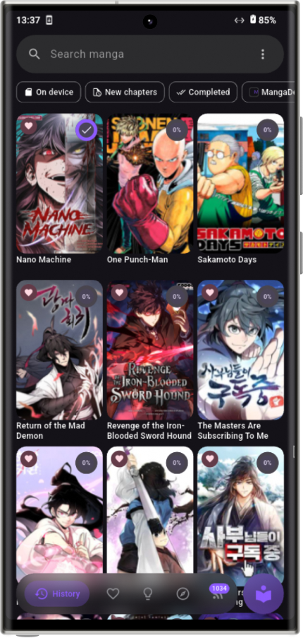</td>
      <td>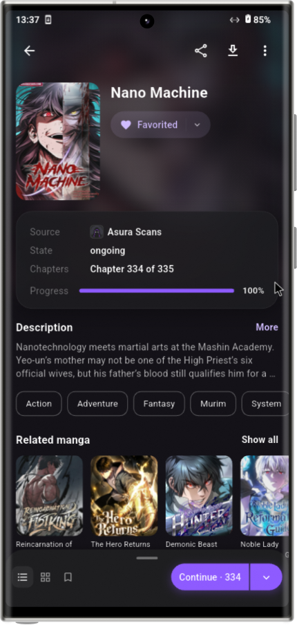</td>
      <td>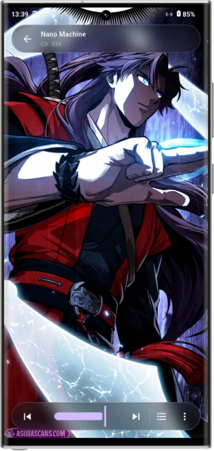</td>
      <td>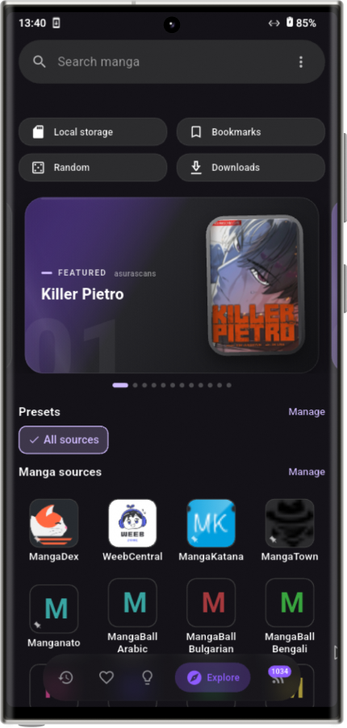</td>
      <td>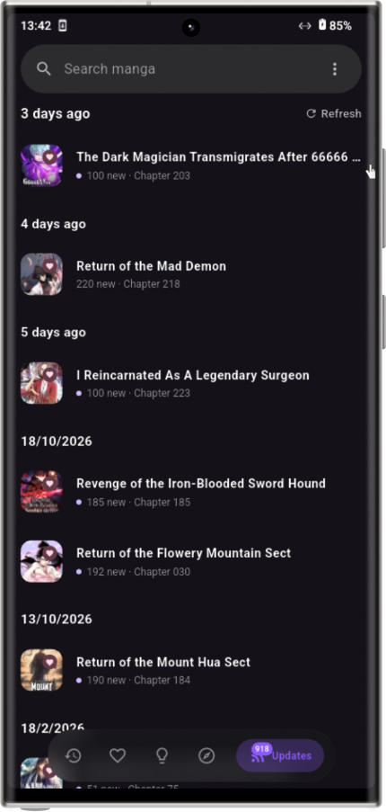</td>
      <td>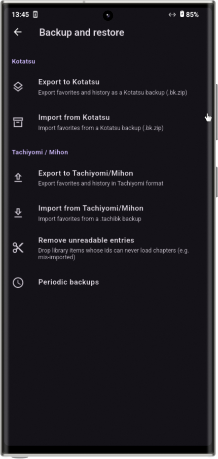</td>
    </tr>
  </table>
</p>

---

<!-- iOS Section -->

#### 🍎 iOS

<p align="center">
  <table>
    <tr>
      <td>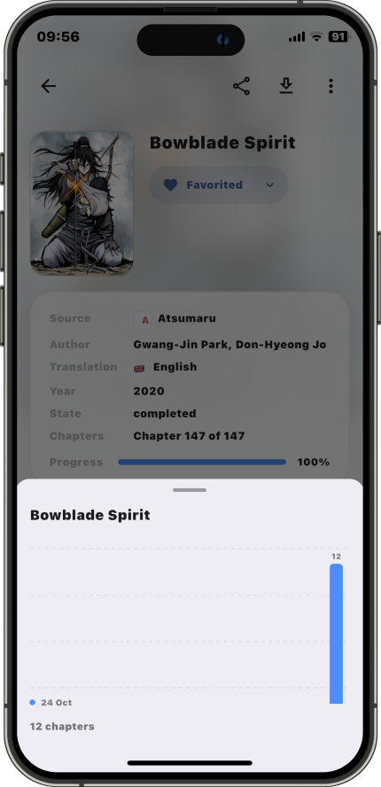</td>
      <td>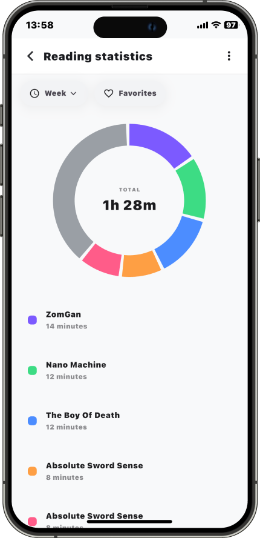</td>
      <td>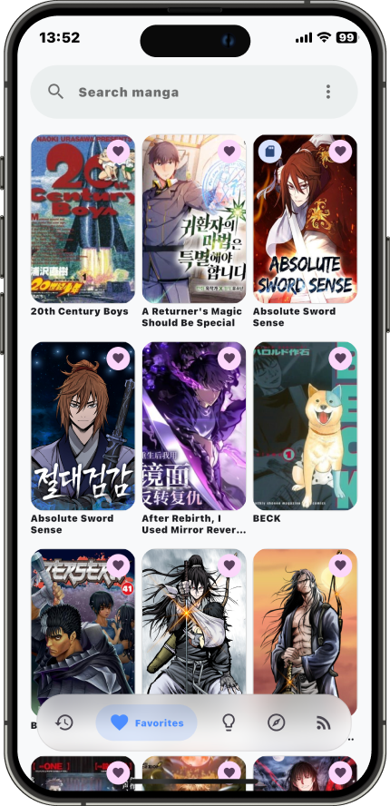</td>
      <td>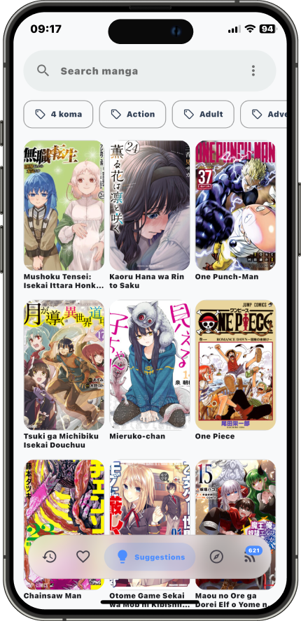</td>
    </tr>
  </table>
</p>

---

<!-- Tablet Section -->

#### 📱 Tablet Layouts

<p align="center">
  <table>
    <tr>
      <td>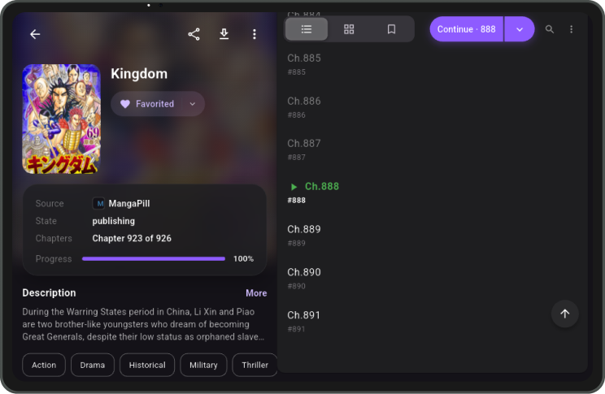</td>
      <td>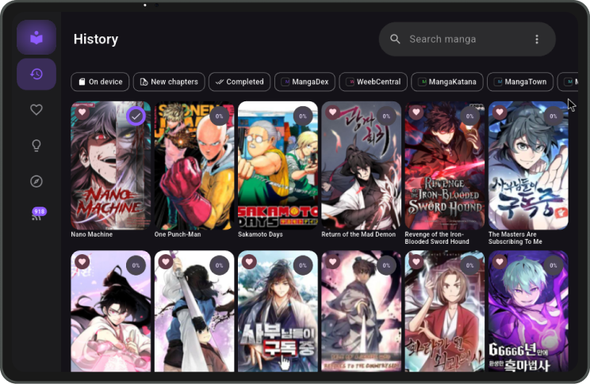</td>
      <td>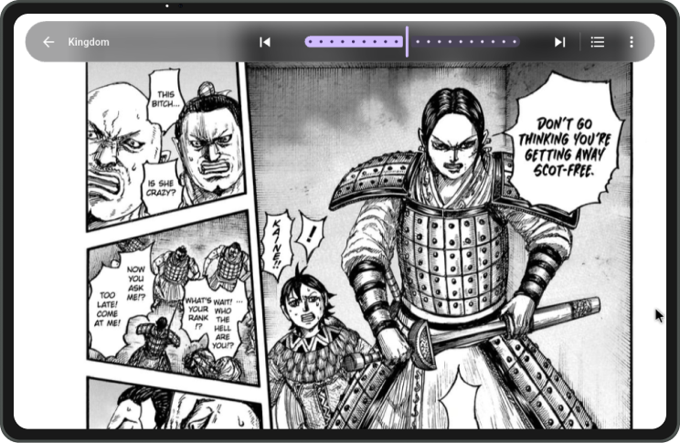</td>
      <td>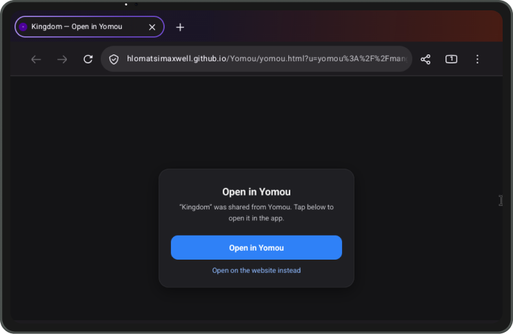</td>
    </tr>
  </table>
</p>

<br>

### Download & Install

#### Android

Every release attaches ready-to-install APKs. Pick the one that matches your device:

| Build | Use it when |
| --- | --- |
| `Yomou-<version>-arm64-v8a.apk` | almost every modern phone or tablet |
| `Yomou-<version>-armeabi-v7a.apk` | older 32-bit devices |
| `Yomou-<version>-x86_64.apk` | Android emulators |
| `Yomou-<version>-universal.apk` | you are not sure which one you need |

> Requires Android 7.0 (API 24) or newer. Installing over an existing copy keeps your library and history.

#### iOS

Each release also attaches an **unsigned** `Yomou-<version>-unsigned.ipa`. Import it into [LiveContainer](https://github.com/LiveContainer/LiveContainer), or sign it yourself with a tool such as [SideStore](https://github.com/SideStore/SideStore) or AltStore.

> Requires iOS 14 or newer.

### Contributing

Issues and pull requests are welcome. If you want to add or fix a source, include the URL you tested it against — sources drift, and a reproducible page is what makes a fix checkable.

Before sending a pull request, run the checks the project uses:

```bash
flutter pub get
flutter analyze
flutter test
```

### Disclaimer

Yomou is a reader, not a content provider. The developers have no affiliation with any of the content available through the app and do not store or distribute any of it; everything the app can reach is already publicly available on the internet. Any takedown request should go to the site that hosts the material.

The app is meant for personal use. Please support the official releases of the works you read.

### Acknowledgments

- [Kotatsu](https://github.com/KotatsuApp/Kotatsu) and [Kotatsu-Redo](https://github.com/Kotatsu-Redo/Kotatsu-Redo) — the design this app follows and the origin of parts of its parser and backup code, which are licensed under GPLv3 and remain so
- [Flutter](https://flutter.dev) and the packages in `pubspec.yaml`
- Icons: [Material Design Icons](https://materialdesignicons.com/) (Pictogrammers), plus glyphs ported from Kotatsu-Redo
- iOS sideloading inspiration: [LiveContainer](https://github.com/LiveContainer/LiveContainer), [SideStore](https://github.com/SideStore/SideStore)
